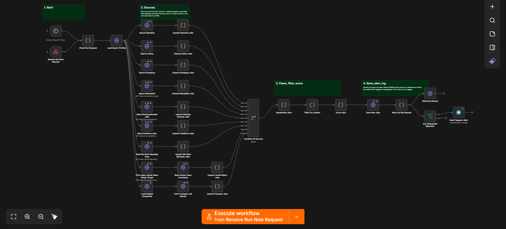
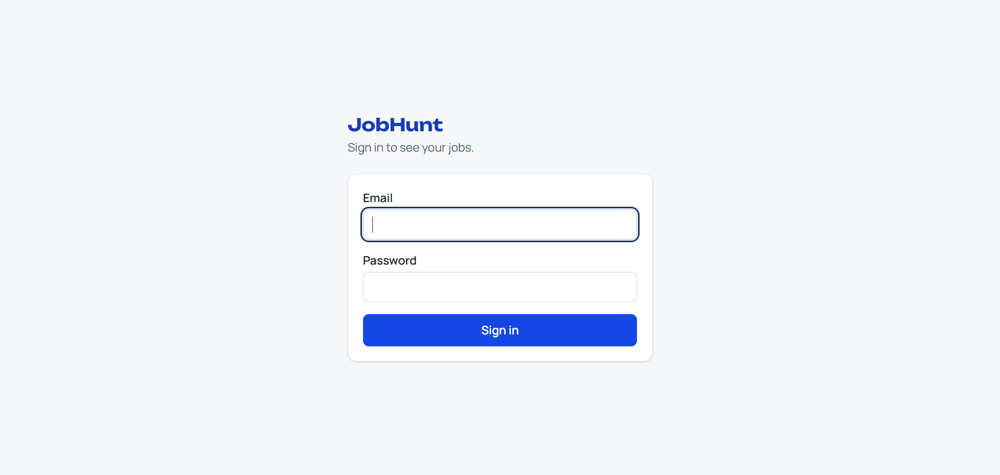

# JobHunt: Automated Opportunity Finder

**A system that searches 10+ sources every day, scores every result, and sends an instant alert when something worth acting on appears.**

   

---

## The problem

Finding the right opportunities means checking many websites every day, reading hundreds of listings, and still missing the good ones. It's slow, repetitive, and easy to get wrong.

## Who it's for

Anyone who needs to keep watch on a lot of information scattered across many places, such as recruiters, agencies, freelancers, and sales teams tracking leads or tenders. This one is set up for job listings. The same approach works for leads, properties, tenders, or any other feed.

## What it does

- **Searches 10+ sources automatically**, including job boards and company career pages, with no manual checking
- **Filters out what doesn't fit**, so you only see relevant results
- **Scores every result** so the best opportunities rise to the top
- **Sends an instant alert** to your phone when a strong match appears
- **Tracks progress in a simple dashboard**: what was found, what you acted on, and which sources work best

## How it works

```
  10+ sources      Remove what       Score each        Save in a        Instant alert
  (job boards, --> doesn't fit  -->  result for   -->  database   -->  on Telegram
  company pages)                     relevance         + dashboard
```

It runs on its own every day, or on demand from the dashboard. If one source is down, the others carry on.

## Screenshots

**The automation (n8n workflow)**



**The dashboard**



## Results

- Checks 10+ sources automatically every day
- Replaces daily manual searching with one instant alert when a strong match appears

## Built with

`n8n` · `Supabase` · `Telegram Bot` · `Next.js` · `TypeScript` · `Tailwind CSS`

## Want something like this?

I build automations like this for businesses: lead capture, follow-ups, and alerts. Get in touch at [walkflow.tech](https://walkflow.tech) or on [LinkedIn](https://linkedin.com/in/walkflow).

---

<sub>Technical note: the dashboard is in `dashboard/` and the database structure is in `supabase/schema.sql`. Copy `.env.example` to `.env` and fill in your own keys to run it. The automation workflow itself is not included in this repository.</sub>
